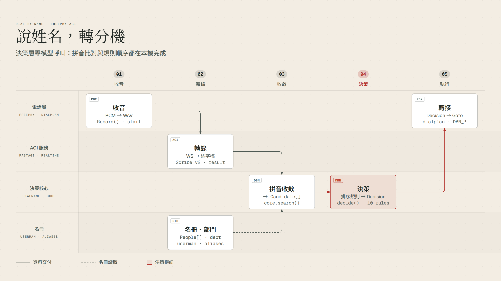

# dial-by-name：說姓名 → 轉分機（中文姓名的同音消歧參考實作）



FreePBX／Asterisk 用的「姓名 → 分機」比對層。來電者說出名字，系統撥接到對應分機，
**不播報號碼、不念姓名**。

這是一份**可執行的參考實作＋量測腳本**，不是產品：目的是把設計決策變成可驗證的數字。
目前只涵蓋中文姓名（繁體正規化＋漢語拼音＋模糊音）；package 名稱不綁語言，
新增語系時在 `normalize()`／`pinyin_variants()` 的 hook 上分派即可。

授權：AGPL-3.0-or-later（見 `LICENSE`）。

---

## 文件地圖

| 想知道                                         | 讀                                                 |
|-----------------------------------------------|---------------------------------------------------|
| 部署主線與先期條件（從零到能撥通、更新、維運） | 本檔「先期條件」「部署主線」「服務管理與開機自啟」 |
| 開發流程（測試、指標、除錯）                   | `AGENTS.md` §4                                     |
| dialplan 片段、`DBN_*`、電話層失敗分派         | `docs/dialplan.md`                                 |
| 設計理由、門檻依據                             | `docs/design.md`                                   |
| 名詞、欄位、常數、19 支提示音內容               | `docs/glossary.md` §9                              |
| JSONL／`DBN_*`／決策→dialplan 對映             | `docs/io-mapping.md`                               |
| 20 通劇本協議                                  | `docs/calls.md`                                    |
| 公開版來源                                     | `docs/provenance.md`                               |

---

## 先期條件

開工前，部署主機上這九項要先成立。缺哪一項，對應那一步就會失敗——不是「先做，之後再補」。

| # | 條件 | 說明 |
|---|---|---|
| 1 | FreePBX＋Asterisk 22+ | dialplan 貼 `extensions_custom.conf`；名冊走 FreePBX userman（`AGI_PBX_DB=1`＋`AGI_SOURCE_DIRECTORY`） |
| 2 | `git`＋`uv` | `git --version && uv --version`。缺 `uv`：`curl -LsSf https://astral.sh/uv/install.sh \| sh`（裝完重開 shell）；`uv` 只用來建部署樹的 `.venv` |
| 3 | 服務帳號 | **建議** `asterisk`（與 Asterisk 寫檔同帳號）；專用帳號是**可選**，代價見下節 |
| 4 | 操作帳號＝`asterisk` | 部署主線全程以 asterisk 直接操作（`/var/lib/asterisk`、`/etc/asterisk` 本為其所有，不需 sudo）；FreePBX 管理指令（`fwconsole`）與補裝系統套件才需要 root |
| 5 | 對外 443（WSS 到 `api.elevenlabs.io`） | 唯一外部依賴。連不出去＝每通都 `fallback` → **總機**（不是掛線） |
| 6 | 本機 `127.0.0.1:4573` | Asterisk→AGI 走 loopback、僅本機；不必開防火牆，也不要對外 listen |
| 7 | DB 唯讀存取 | `/etc/freepbx.conf` 可讀（建議 asterisk 帳號的預設路徑），或 `.env` 補齊 `DBN_MYSQL_*` 四鍵；兩邊都不成＝拒絕啟動 |
| 8 | FreePBX 設定面 | `DBN_OPERATOR` 的落點（總機分機／ring group）、Inbound Route／Custom Destination；貼法見 `docs/dialplan.md` §2、§3.1–§3.2 |
| 9 | `ELEVENLABS_API_KEY` | 只寫進部署樹的 `.env`（第 4 步），不進指令行、不進版控 |

### 部署目錄與服務帳號（建議＋條件）

**目錄：建議 `/var/lib/asterisk/dial-by-name`**——兩場真機實撥走的就是這條路徑。可以換，但三條要同時成立：

1. 服務帳號對部署樹**可讀可執行**（`.venv/bin/python`、`dialname/`、`data/`、`scripts/`），對 `out/` 與 `recordings/` **可寫**；
2. 不在 Asterisk／FreePBX 自管路徑（`sounds/`、`moh/`）底下——那兩棵 FreePBX 會重寫；
3. `DBN_SOUND`／`DBN_OPERATOR` 等 dialplan 變數的地點對得上（換樹不影響音檔絕對路徑，但要自己確認）。

**帳號：建議 `asterisk`**。與 Asterisk 同帳號寫檔＝`recordings/` 零權限工程（`Record()`／`MixMonitor()` 落的 wav，AGI 與 sweeper 直接可讀可刪），DB 走 `/etc/freepbx.conf` 也免設定。

**可選：專用帳號**（例如 `dbn`）。隔離更好，代價三條：

1. `recordings/` 要共享群組＋setgid（`sudo chgrp asterisk recordings && sudo chmod 2770 recordings`），否則 Asterisk 寫的 wav 服務刪不掉；
2. `.env` **必須**補 `DBN_MYSQL_*` 四鍵（專用帳號讀不到 `/etc/freepbx.conf`）；
3. 啟動改以該帳號登入（或 `sudo -u <帳號>`）；本檔預設全程以 asterisk 直接執行。

---

## 部署主線：從零到撥通

全程在**部署主機**上、cwd 一律部署樹；每一步的產物就是後續步驟引用的路徑。
決策層沒綠的版本不要接電話；開發端回歸（`uv run pytest -q`／`eval.py`）見 `AGENTS.md` §4。
以下全程以 `asterisk` 帳號執行（`ssh asterisk@<pbx>`）；`/var/lib/asterisk`、`/etc/asterisk`
本為 asterisk 所有，不需要 sudo。

### 1. 部署樹：`git clone`

```bash
git clone <repo-url> /var/lib/asterisk/dial-by-name
cd /var/lib/asterisk/dial-by-name
git checkout <tag-or-commit>   # 選用：鎖版本，部署可重現
```

- 目錄用建議值（理由與替代條件見「先期條件」）；部署樹由這一步產生，後續步驟的路徑都在樹內。
  目標目錄必須**不存在或為空**（`git clone` 不進非空目錄）。
- 樹屬於操作帳號（本帳號 clone）：服務直接讀寫樹內自有目錄，不需 `chown`。
- 服務以這棵樹的 `.venv/bin/python` 執行；`scripts/agi.sh` 用腳本位置推算根目錄，不依賴 cwd。

### 2. 依賴：`uv sync`

```bash
cd /var/lib/asterisk/dial-by-name
uv sync     # 產部署樹的 .venv/（依 pyproject.toml + uv.lock；不入版控）
```

- 這棵 `.venv` 只給服務用；開發端的 `uv run …`（測試、指標）見 `AGENTS.md` §4，兩邊不共用。
- `uv` 裝在 `~/.local/bin` 而 PATH 找不到時：`~/.local/bin/uv sync`（或先
  `export PATH="$HOME/.local/bin:$PATH"`）。
- 之後依賴若變（`pyproject.toml`／`uv.lock` 有動）→ 重跑這一步再 `restart`，見第 10 步。

### 3. 執行目錄與權限

```bash
cd /var/lib/asterisk/dial-by-name
mkdir -p recordings out/calls
chmod -R 0770 recordings out
touch recordings/.probe out/calls/.probe
rm recordings/.probe out/calls/.probe
```

- Asterisk 的 `Record()`／`MixMonitor()` **不會自建目錄**：`recordings/` 不存在＝錄音失敗
  （`RECORD_STATUS=ERROR` → `retry` → 掛線）。
- `recordings/` 只放通話中的暫存 wav：走到 `result` 即刪，其餘由 sweeper 在 20 秒內清；
  靜止時必須是空的（有殘檔＝sweeper 沒在跑）。
- `out/calls/` 是 JSONL 落點（`AGI_LOGS` 預設）；`out/` 另有 `agi.log`／`agi.pid`／`agi.health.json`。
- 權限 probe 兩個目錄都要過；`touch` 失敗＝服務寫不進去。
- 服務帳號不是 `asterisk` 時：這一段改由 root 一次設定（`chown` 該帳號＋`recordings/` 共享群組／setgid，
  見「先期條件」→「可選：專用帳號」）。

### 4. `.env`

```bash
cd /var/lib/asterisk/dial-by-name
tee .env >/dev/null <<'EOF'
ELEVENLABS_API_KEY=
AGI_PBX_DB=1
AGI_SOURCE_DIRECTORY="Test Directory"
DBN_MYSQL_HOST=127.0.0.1
DBN_MYSQL_USER=dbn_ro
DBN_MYSQL_PASS=
DBN_MYSQL_DB=asterisk
EOF
chmod 600 .env
```

- repo 刻意不含 `.env`：金鑰不入版控。只寫 `KEY=value`，**不要加 `export`**（`scripts/agi.sh`
  用 `set -a` 載入，值有空格要加引號）。
- `AGI_PBX_DB=1`＋`AGI_SOURCE_DIRECTORY`（換成你的 userman 目錄名，值要加引號）＝正式名冊；
  拿掉這兩行則退回 `data/people.json` 示範名冊（40 人，僅供離線開發）。
- `DBN_MYSQL_*` 四鍵全有才用；缺任一 fallback `/etc/freepbx.conf`（需 asterisk 可讀），
  兩邊都不齊或連線失敗 → 拒絕啟動。
- 用專用帳號時：`.env` 的 owner 改該帳號，且 `DBN_MYSQL_*` 四鍵**必填**（讀不到 `/etc/freepbx.conf`）。

### 5. `data/aliases.json`（userman 名冊的別名清單）

```bash
cp data/aliases.example.json data/aliases.json
chmod 600 data/aliases.json
```

改成你的 `source_directory`（逐字等於 userman 目錄名）與 `user_id → 小名`。repo 刻意不含正式檔：
含真名，隱私。稀疏登記即可；離職未刪的孤兒 `user_id` 會讓 reload 永遠失敗。

### 6. 提示音 19 支 → `/var/lib/asterisk/sounds/dbn/zh/`

音檔是這條主線**唯一的外部輸入**：repo 不含、也無法由前面的步驟生成——在**開發端**
錄製或合成（每支要念什麼、何時播見 [`docs/glossary.md`](docs/glossary.md) §9）、
用 `scripts/check_sounds.py` 驗格式，再傳上部署主機。

```bash
# 開發端先驗格式（8 kHz／mono／16-bit、檔名 ASCII）
uv run scripts/check_sounds.py <你的音檔目錄>
# 上傳（音檔不可能進 repo，只能用檔案傳輸）
rsync -av <你的音檔目錄>/ asterisk@<pbx>:/var/lib/asterisk/sounds/dbn/zh/
```

repo 刻意不含音檔：真人錄音／TTS 資產的再散布條件另計，自行錄製或合成。
**`dbn/` 這層必須與 dialplan 的 `DBN_SOUND` 逐字一致**：少一層＝`Playback` 全無聲、且沒有明顯報錯。

### 7. dialplan：貼上與 reload

`[dbn-main]`／`[dbn-play-speech]` 貼進 Admin → Config Edit → `extensions_custom.conf`，然後：

```bash
asterisk -rx 'dialplan reload'
```

（FreePBX GUI 貼上的話，按 GUI 的 Apply Config 亦可；`fwconsole` 需要 root，`asterisk -rx` 以
asterisk 身分即可。）

片段本文、逐行語意與 GUI 接入（Custom Destination／Inbound Route／內部分機測試）見
`docs/dialplan.md` §2、§3.1–§3.4。**不要**放進 `[from-internal-custom]`：它永遠被 include 進
`from-internal`，`exten => s` 會變成內部分機可撥。

### 8. 啟動 FastAGI＋金絲雀

```bash
cd /var/lib/asterisk/dial-by-name
scripts/agi.sh start
tail -n 5 out/agi.log        # 必須有 roster: source=... people=N aliases=M departments=D
```

`people=N` 要對上名冊人數（userman 目錄的真實人數）。`scripts/agi.sh status` 另檢
PID／4573／sweeper heartbeat；啟停、health 判定與人員異動見本檔「服務管理與開機自啟」。

### 9. 冒煙一通

先跑 `docs/dialplan.md` §3.8 的兩項檢查（STT 對外、決策管線，不必撥號），再用 Local channel
撥 `s@dbn-main`；正式進線走 `docs/dialplan.md` §3.2–§3.3 的 Custom Destination／Inbound Route。
判讀看 JSONL 的 `DBN_ACTION`／`reason`。

之後：20 通劇本照 `docs/calls.md` 撥與判。

### 10. 更新既有部署

```bash
cd /var/lib/asterisk/dial-by-name
git pull
scripts/agi.sh restart    # 改過程式碼／依賴／.env
scripts/agi.sh reload     # 只改名冊（userman／aliases.json）
```

- 依賴有變（`pyproject.toml`／`uv.lock` 有動）→ **先重跑第 2 步**再 `restart`。
  `.venv` 與 `uv.lock` 不一致時進程會 import 失敗，log 只看得到 traceback。
- 只改 `aliases.json`／`departments.json` → `reload` 就夠（SIGHUP 原子重載名冊，進行中的 session 不重置）。

既有 rsync 部署遷移（路徑不變，先讓位）：

```bash
mv /var/lib/asterisk/dial-by-name /var/lib/asterisk/dial-by-name-old
git clone <repo-url> /var/lib/asterisk/dial-by-name
cp -p /var/lib/asterisk/dial-by-name-old/.env /var/lib/asterisk/dial-by-name/
cp -p /var/lib/asterisk/dial-by-name-old/data/aliases.json /var/lib/asterisk/dial-by-name/data/
# 從第 2 步接到第 9 步（依賴同步不可省）；金絲雀確認後刪舊樹
rm -rf /var/lib/asterisk/dial-by-name-old    # 不要動 dial-by-name-archive
```

舊樹只搬 `.env` 與 `aliases.json`（含金鑰與真名，不經 git）；`recordings/`／`out/` 由第 3 步重建，
不搬。

---

## 服務管理與開機自啟

### 現狀

正式運行模式＝手動 `scripts/agi.sh`（2026-11-25 裁定：不實裝 systemd unit）。
**重開機不會自動起服務**；開機後需手動 `scripts/agi.sh start`。

### 手動方式（正式模式）

```bash
cd /var/lib/asterisk/dial-by-name

# 啟動／停止／重啟（.env 已含 userman 設定：AGI_PBX_DB=1、AGI_SOURCE_DIRECTORY）
scripts/agi.sh start
scripts/agi.sh restart       # 改程式碼、換 AGI_LOGS、改 .env 後用
scripts/agi.sh reload        # SIGHUP：原子重載名冊（userman／aliases.json 異動後用；不換程式碼）
scripts/agi.sh stop

# 狀態（可腳本判定：running 但 sweeper 不健康 → 非零退出碼）
scripts/agi.sh status

# 驗收場次專屬日誌（撥打前設置，勿與生產日誌共用）
AGI_LOGS=out/calls/test-YYYYMMDD scripts/agi.sh restart
```

每次啟動／重啟後的金絲雀驗證：

```bash
tail -n 5 out/agi.log   # 必須看到 roster: source='Test Directory' people=N aliases=M departments=D
```

指令之外的語意（`scripts/agi.sh`）：

- `foreground`＝前景執行，Ctrl+C 停止、log 直接看；背景模式 PID 寫 `out/agi.pid`、log 寫 `out/agi.log`。
- 預設 listen `127.0.0.1:4573`；換埠 `AGI_LISTEN=127.0.0.1:4574 scripts/agi.sh start`。
- 換名冊（臨時驗收）：`AGI_DIRECTORY=/path/to/roster.json scripts/agi.sh start`。**systemd 不讀這個變數**——那條路的 `--directory` 寫在 unit 的 `ExecStart`，要改 unit 或加 drop-in。
- userman 模式：`AGI_PBX_DB=1 AGI_SOURCE_DIRECTORY='<你的 directory 名>' scripts/agi.sh start`
  （`AGI_ALIASES`／`AGI_DEPARTMENTS` 可換路徑）；回滾＝拿掉 `AGI_PBX_DB` 重啟。
  換其他名冊只改 `--source-directory` 一個值，補撥 2–3 通驗證即可。
- 名冊旗標（手動與 systemd 的 `ExecStart` 同一組）：
  `--pbx-db --source-directory '<你的 directory 名>' --aliases data/aliases.json --departments data/departments.json`。
- 若 `.env` 存在會自動 source，key 不進指令行、不進 shell 歷史；其他參數原樣傳給
  `agi_server.py`（例 `--health out/agi.health.json`）。
- `status` 除了 PID／port，也讀 `out/agi.health.json`（sweeper 每 1 秒寫一次）：
  heartbeat 超過 5 秒沒更新、pid 不符或檔不存在 → `sweeper: DEAD`，退出碼 1；
  `active` 是當下的 session 數，`jsonl:` 是最新一輪的 `ts`。sweeper 死掉時行程與 port
  可能都還在，但過期 session 會永佔並發閘——所以它算 liveness，不是加分項。
  `AGI_HEALTH` 可換 heartbeat 路徑（預設 `out/agi.health.json`）。
- `reload` 只支援 `start` 的背景模式（要有 `out/agi.log`）：腳本送 HUP 後等 10 秒，
  抓最新一筆 `reload ok|failed`；`reload failed` 時服務仍在跑（舊索引），退出碼 1。
  SIGHUP 只換名冊，**進行中的 session 不重置**（`TurnManager` 跨 reload 存活）。
- 背景模式看 log：`tail -f out/agi.log`。
- **不要和 systemd 同時跑**（port 衝突）。手動模式是正式模式，重開機不會自動起。

### 人員異動

1. userman 改人／外部目錄同步：`sudo fwconsole userman --syncall --force`（FreePBX 管理指令需 root；AD/LDAP 先拉進 DB）。
   userman 本身**不需要** Apply Config：姓名、部門、分機綁定只寫 `userman_users`，
   AGI 直接 SELECT。例外是同一批動到分機（Extensions，含 Quick Create 建的使用者）、queue、
   ring group、inbound route，或改了 `extensions_custom.conf`——那才需要 reload dialplan
   （`asterisk -rx 'dialplan reload'`，或 GUI 的 Apply Config），
   漏了它 `Dial(Local/<ext>@from-internal)` 會找不到新分機。
2. 離職：同步刪掉 `data/aliases.json` 裡該 `user_id`（孤兒 alias 會讓 reload 永遠失敗）。
3. `uv run scripts/check_aliases.py --source-directory '<你的 directory 名>'` 退出碼 0。
4. `scripts/agi.sh reload` → 必須看到 `reload ok: people=N aliases=M (was K)`；
   `reload failed` 時服務仍用舊索引，修好再 reload。進行中的 session 不重置。
5. `aliases.json`／`departments.json` 一律「寫暫存檔 → `mv` 取代」，避免半寫入碰上 HUP。
6. 金絲雀：`tail -n 5 out/agi.log` 的 `people=N` 要等於變更後的人數。

### 故障演練：STT key 失效

```bash
cd /var/lib/asterisk/dial-by-name
cp -p .env /tmp/dbn.env.bak
sed -i '/^ELEVENLABS_API_KEY=/s/=.*/=/' .env   # 清空值，不刪行
scripts/agi.sh restart
# 撥一通 → out/calls/YYYYMMDD.jsonl 該輪應見 "stt_status":"auth"、DBN_ACTION=fallback → 總機
mv /tmp/dbn.env.bak .env && scripts/agi.sh restart
```

`auth`（握手 401／403 或缺 key）與 `ws`（WS 事件層錯誤）都落 `fallback` → 總機；
分類的權威是 `docs/io-mapping.md` §3。

### systemd（選用，開機自啟）

```ini
# /etc/systemd/system/dial-by-name-agi.service
[Unit]
Description=dial-by-name FastAGI (Realtime STT, Test Directory roster)
After=network.target

[Service]
Type=simple
User=asterisk
Group=asterisk
WorkingDirectory=/var/lib/asterisk/dial-by-name
EnvironmentFile=/var/lib/asterisk/dial-by-name/.env
ExecStart=/var/lib/asterisk/dial-by-name/.venv/bin/python agi_server.py \
  --pbx-db --source-directory "Test Directory" \
  --logs out/calls --health out/agi.health.json
ExecReload=/bin/kill -HUP $MAINPID
Restart=on-failure

[Install]
WantedBy=multi-user.target
```

安裝與驗證：

```bash
sudo cp dial-by-name-agi.service /etc/systemd/system/
sudo systemctl daemon-reload
sudo systemctl enable --now dial-by-name-agi
systemctl --no-pager status dial-by-name-agi   # 權威：active (running)
scripts/agi.sh status                          # 只看 sweeper 段（pid 檔不認 systemd 進程，會顯示 stopped）
grep "roster: source" out/agi.log | tail -1    # 金絲雀：people=13
```

注意事項：

- `EnvironmentFile` 只為 `ELEVENLABS_API_KEY`（`.env` 權限 600、owner asterisk）；
  名冊模式由 `ExecStart` 的 flag 決定，`AGI_*` 環境變數是 wrapper 專用。
- `ExecReload` SIGHUP＝只換名冊；**改程式碼仍需 restart**（新進程）。
- `Restart=on-failure` 是對無聲死亡的防護，不是萬靈丹——systemd 模式的權威是
  `systemctl status`，手動模式的權威是 `scripts/agi.sh status`。
- `scripts/agi.sh status` 的 pid 判定讀 `out/agi.pid`（只有 `agi.sh start` 會寫）：
  systemd 起的進程在它眼裡是 `stopped`；同一段輸出裡的 `ss` 監聽行與 sweeper heartbeat 仍有效。
- DB 連線走 `/etc/freepbx.conf` fallback；要唯讀帳號就補 `DBN_MYSQL_*` 四鍵到 `.env`。
- 本節（含「人員異動」「故障演練」）是服務啟停與維運的單一來源；`docs/dialplan.md` 不重複。

---

## 音檔：本 repo 不含提示音

系統會播 19 支提示音（`welcome`、`processing`、`retry`、`q-*`、`dept-*`、`transferring`…）。
每支要念什麼、何時播、哪些只在 `disclose_names=True` 使用，見
[`docs/glossary.md`](docs/glossary.md) §9；部署指令見「部署主線」第 6 步。

| 項目 | 值 |
|---|---|
| 數量與格式 | 19 支 `.wav`，**8 kHz／mono／16-bit**，檔名純 ASCII |
| 檔名清單（機器驗證） | `scripts/check_sounds.py` 的 `EXPECTED`（不要另外抄一份） |
| 內容與話術 | [`docs/glossary.md`](docs/glossary.md) §9（逐支：念什麼、何時播、`disclose_names` 分支） |
| 部署位置 | **`/var/lib/asterisk/sounds/dbn/zh/`**（由 dialplan 的 `DBN_SOUND` 決定） |
| 驗證（開發端） | `uv run scripts/check_sounds.py <你的暫存目錄>`（缺檔／格式錯／非 ASCII 都會列出來） |

上傳指令見「部署主線」第 6 步。少了 `dbn/` 這一層（只放到
`/var/lib/asterisk/sounds/zh/`）的後果是 `Playback` **全無聲、且沒有明顯報錯**——這是最常見的部署錯誤。

clip key 的三段對照：

| 決策層（`Decision.speech`） | 通道變數 | dialplan |
|---|---|---|
| `sounds/zh/q-say-full-name` | `DBN_SPEECH=q-say-full-name` | `Playback(${DBN_SOUND}/q-say-full-name)` |

決策層只吐**標籤**：`dialname/agi.py` 的 `_clip_name()` 剝掉 `sounds/zh/` 前綴，
所以 repo 內不存在 `sounds/` 目錄也不影響決策與測試。

**已知限制**：`disclose_names=True`（念出姓名澄清）需要的四支固定句
`q-is-it`／`q-or`／`q-question`／`transferring-name` **未實作**，`agi_server.py` 也沒有對應旗標。
預設 `disclose_names=False` 不會用到它們；那個分支是內線專用部署的工作，不在本 repo 範圍。

---

## 架構

```
來電 ──► FreePBX dialplan（收音／播音／轉接／回合，全在 dialplan）
             │  Record → processing
             ▼
        FastAGI 127.0.0.1:4573        ── agi_server.py（threaded，SIGHUP 原子重載）
             │
             ▼
        AGI start / result   ── dialname/agi.py（兩相）
             │  start：旁路 wav 登記 session，立即返回（不設通道變數）
             │  result：① tail 旁路 wav → Realtime STT（ElevenLabs）→ 逐字稿
             │  ② core：正規化 → 拼音 → 模糊音 → top-8 候選（1–3 ms）
             │  ③ decision.decide()：轉／問一句／交總機
             ▼
        DBN_ACTION / DBN_REASON / DBN_TARGET / DBN_DEPT / DBN_SPEECH
             │
             ▼
        dialplan 依 DBN_* 動作：Dial(Local/…@from-internal) 或 播下一句
```

**AGI 只做 STT＋決策**；收音、播音、轉接、回合計數全在 dialplan。這個切法的好處是
**跨輪**通話狀態只有一處（dialplan）；AGI 只在一輪之內保存 session（`start` 登記、`result` 收工，
過期 session 與 wav 由 TTL 20 秒的 sweeper 清），壞掉時 dialplan 有安全網（`AGISTATUS` → 總機）。

部署主線見本檔「部署主線：從零到撥通」；dialplan 片段與電話層落點見 `docs/dialplan.md`；
服務啟停與（選用）systemd unit 見「服務管理與開機自啟」。

### 檔案佈局

```
dialname/core.py           正規化、拼音變體、模糊音、評分、索引桶、部門解析、澄清判斷
dialname/decision.py       決策樹 decide()、clarify_plan、姓名音檔命名（clip_hash／manifest）
dialname/agi.py            AGI 兩相處理器（start／result）＋薄協議層（不碰電話層）
dialname/stt_client.py     ElevenLabs Scribe v2 批次 adapter（wav → Transcript）
dialname/stt_realtime.py   ElevenLabs Realtime WS client（PCM 串流／事件解析／錯誤分類）
dialname/turns.py          TurnManager：一輪一 session、WAV tail、TTL sweeper
dialname/health.py         sweeper heartbeat／status 判定（out/agi.health.json）
dialname/pbx_directory.py  正式名冊入口：userman＋aliases.json＋departments.json
agi_server.py  eval.py  trace.py  demo.py  stt_batch.py
docs/design.md             設計與理由（不變式、決策順序、門檻、外部模型、名冊、回歸）
docs/dialplan.md           dialplan 片段、DBN_* 變數、失敗分派
docs/calls.md              20 通劇本協議與判定（表格由 scripts/calls.py table 產生）
docs/glossary.md           欄位／列舉值字典、常數表
docs/io-mapping.md         五段 I/O 邊界、Decision → PBX
docs/provenance.md         這個公開版的來源
data/people.json           40 人／8 部門的合成示範名冊
data/departments.json      8 部門定義（dept_id 契約）
data/call_script.json      20 通劇本的機器判定
scripts/                   agi.sh／calls.py／check_sounds.py／check_aliases.py／jev_probe.py／install-hooks.sh
tests/                     241 個 pytest（L0 golden、L1 劇本、AGI、Realtime、名冊、alias 政策…）
```

---

## 7 條不變式

改任何東西之前先確認這七條還成立（完整理由與決策順序見 `docs/design.md` §1）：

1. **決策順序不可調換**。
2. **同音兄弟一律本地解**：跨部門問部門、同部門 fallback，不猜。
3. **「不需澄清」與「只有一個候選」優先於任何追問**。
4. **(d) 只問一次**：第二輪仍拉鋸 → `clarify-exhausted`；任何路徑不得產生第三次追問。
5. **決策層零外部呼叫**：`decide()` 沒有委派參數，`dialname/` 內沒有通往外部 API 的路徑。
6. **部門路由鍵是 ASCII `dept_id`**；中文部門名只進 log，不進檔名／dialplan／通道變數。
7. **入口只 import `dialname`**：`eval.py`／`trace.py`／`demo.py`／`agi_server.py`／`stt_batch.py`
   不得自行實作正規化、評分、門檻或決策。

---

## 為什麼不讓模型直接吃整本電話簿

500 個人的候選清單同時造成三件事：token 成本與延遲隨人數線性上升；選項一多，
機率分布被攤平、`confidence` 失去鑑別度；同音字（王/汪、張/章）本來就只有**發音**能分辨，
把判斷丟給語言模型等於要它做字串比對——那是本地 3 ms 就能做完的事。

所以分工是「本地索引收斂候選 → 本地決策」，**整本電話簿永遠不出機器**。
現行版本連「少數候選」也不外送：2026-11-21 起決策層零外部模型存取，
理由、可達率證據與重開條件見 `docs/design.md` §4。

---

## 評分與決策（摘要）

```
score = 0.20 × 漢字逐字 + 0.16 × 漢字部分 + 0.30 × 姓拼音
      + 0.14 × 字數 + 0.10 × 名拼音 + 0.10 × 聲母序
部門：同部門 +0.10、不同部門 −0.08；職稱 +0.04
```

優先序是**姓 > 字數 > 名**：中文姓是封閉集合（幾百個），同音的姓幾乎等於同一個人；
名字發散，同音只能當輔助。門檻與權重的數值、以及「為什麼是這些值」見 `docs/design.md` §3。

決策十條順序（掛線／部門／重問／只講姓／漏字／不需澄清／單一候選／同音兄弟／問一句）
見 `docs/design.md` §2；那是**程式碼順序**，調換就是改行為。

---

## 同音：三種情況

| 情況 | 例 | 本地能做的 | 剩下交給誰 |
|---|---|---|---|
| A. 真同音，只有一個人 | 名冊只有張家豪，STT 給章家豪 | 拼音相同 → 1.0 命中 | 直接轉 |
| B. 真同音，兩個都在 | 張家豪（工程）、章家豪（財務） | 兩個都高分、差距小 | 一定先澄清 |
| C. 字面命中另一個人 | 查「汪偉」，名冊有王偉（業務）與汪偉（客服） | top1 1.00、margin 0.21，看起來很有信心 | ⚠️ 最危險 |

C 是純 margin 檢查抓不到的：分數差看起來安全，但兩個人**同音**，而 STT 的錯誤正是
把「王」聽成「汪」。所以除了第二名的分數門檻，還有 `same_surname_homophone()`
（同姓＋名同音不同字，不看分數）與 `confusable()`（tight／loose 拼音鍵交集）。

---

## 隱私

電話簿是「撥得到就能查」的服務。系統只要開口念出名字，就等於提供列舉介面
（換 20 個姓氏就能蒐集全公司名單）。三條規則（`disclose_names=False`，預設）：

| 規則 | 做法 |
|---|---|
| 不念名字 | 澄清一律播「請說全名」；轉接只播「為您轉接」 |
| 不確認存在 | 回覆內容與「這個人存不存在」無關，避免變成 oracle |
| 不列舉數量 | 不說「有 2 位符合」 |

**按鍵只用來選「部門／總機」，永遠不用來盲選人。** 沒有名字的「按 1／按 2」對來電者
毫無意義：他如果分得出是哪一位就不需要澄清；分不出來，更不可能知道 1 和 2 各是誰。

唯一的第三方是 STT（ElevenLabs Scribe v2），它聽到的本來就是來電者的語音。
`data/aliases.json`（小名 sidecar）含真名，不入版控；`data/aliases.example.json` 是範本。

---

## 量測

### 合成測資（回歸訊號，不是準確率）

> **這些數字是合成的。** 342 題由對照表模擬 STT 同音錯誤（先過 OpenCC 簡化，模擬真實引擎的
> 輸出字形），不是真實錄音。用途只有一個：**規則壞掉時會掉下來**。
> 它們**不是**對外宣稱的準確率，也不該當設計依據。

| 指標 | 數值 |
|---|---|
| 簡體全名／漏字／英文／贅詞 top-1 | 1.000 |
| 繁體全名 top-1（對照組，`sc_vs_tc_gap`） | 1.000（gap 0.000） |
| 疑難查詢（同音、只講姓、只講名、部門+姓）recall@3 | 1.000 |
| 部門辨識（只講部門） | 1.000 |
| 疑難查詢觸發澄清的比例 | 0.990 |
| 無歧義查詢被多問一次的比例 | 0.230（其中多數真的有名冊內的同音鄰居） |
| **誤轉率**（沒澄清且答錯） | **0.000** |
| 同音＋報了部門 top-1（`homophone_dept_top1`） | **1.000** |
| 亂句硬抓到人的比例（16 句） | 0.000 |
| 資訊不足時不追問的比例（只講姓／只有稱謂／漏字） | 1.000 |
| 第 2 輪仍歧義時**又**問第三次的比例 | 0.000 |

消融（同音＋報部門的 top-1）：部門加權與部門收斂單獨開啟都能到 1.000，
兩者都關掉是 0.444；現況兩者都開。分工與門檻理由見 `docs/design.md` §3.2。

### 效能（純 Python，單核）

| 名冊人數 | 首音節桶＋低信心回掃 | 暴力全掃 | 加速 |
|---|---|---|---|
| 40 | 1.96 ms | 5.24 ms | 2.7× |
| 200 | 2.00 ms | 23.95 ms | 12.0× |
| 500 | 4.84 ms | 63.99 ms | 13.2× |
| 2000 | 12.09 ms | 206.99 ms | 17.1× |

兩個關鍵優化：查詢的拼音特徵只算一次；首音節桶＋低信心回退全掃（同音字的拼音首音節
必然相同，所以桶不會漏掉同音候選）。

### 真實通話

`eval.py --calls` 可以吃「通話日誌＋truth.csv」算同一套指標：通話中 AGI 只寫 JSONL
（逐字稿＋決策），撥完之後才把正確答案接上去評分，答案卡不參與通話當下的任何決策。
欄位與流程見 `docs/calls.md` §4 與 `docs/dialplan.md` §3.9。

**本 repo 不含任何真實通話語料**（含個資）。真實 WER 請用自己的錄音量。

---

## 已知限制

- **真實 WER 未量測**：8 kHz 窄頻＋台灣國語＋姓名，STT 的錯誤型態是可觀察的「整詞替換」，
  但比例要靠你自己的錄音。合成測資不回答這個問題。
- **keyterms 未啟用**：ElevenLabs 的 keyterms 可用來 bias 辨識，但模型輸出簡體、
  送繁體 keyterm 可能白費；需要 A/B 驗證（`stt_batch.py --audio-dir … --truth …` 三組共用同一份 truth）。
- **`disclose_names=True` 未完整**：見上面的音檔章節。
- **STT 全斷沒有 fast-fail**：WS 連不上／中斷且無 transcript → `fallback`／`stream-error` → 總機；
  `result` 端總預算 3 秒（`RESULT_TIMEOUT`），沒有熔斷、沒有指數退避——WS 卡在握手就是等滿
  3 秒才落總機。401／403 與壞 key 一律落總機（2026-11-23 翻案 PoC 的掛線；
  `auth`／`ws` 分界見 `docs/io-mapping.md` §3）。
- **並發閘 4（寫死）**：四個沒走到 `result` 的 session 在 20 秒 TTL 內佔滿閘，期間新話務
  全量落總機（availability cliff）。
- **TTL 20 秒＝隱私窗口**：OPERATOR／HANGUP／ERROR／閘滿 stub 的 wav 由 sweeper 在 20 秒內刪；
  服務若被 `kill -9`，sweeper 也停止，殘留檔沒有外部清理器。`scripts/agi.sh status` 以
  heartbeat 新舊判 sweeper 死活（超過 5 秒＝DEAD）。
- **故障觀測面**是 `out/calls/*.jsonl` 的 `stt_status`／`stream.status` 與 `scripts/agi.sh status`；
  沒有告警、沒有 metrics 匯出（刻意不做）。
- **同部門同音兄弟**：示範名冊的同音對都刻意跨部門，沒有同部門同音對可測；真機第二場
  遇到同部門同音時行為＝`homophone-unresolvable` → 總機（安全拒猜），合成測資未覆蓋。
- **Go 移植**只有對照表（`docs/design.md` §3 的常數是唯一來源），沒有實作。

---

## 回歸與變更紀律

- 改 `dialname/`、`eval.py`、`data/people.json` 之後跑 `uv run pytest -q`；`scripts/install-hooks.sh`
  裝的 pre-commit 會在這些路徑 staged 時先跑 L0／L1，非零即拒絕 commit。
- **不要為了讓測試過而放寬門檻**：先判斷是規則錯還是測資錯。
- 刻意改行為 → 用 `scripts/calls.py update` 搬 `expect` 並看 diff，再依 `tests/golden/README.md`
  更新 golden，並在 `CHANGELOG.md` 記一筆。
- 版本變更見 `CHANGELOG.md`；下一步見 `ROADMAP.md`；安全回報見 `SECURITY.md`。
